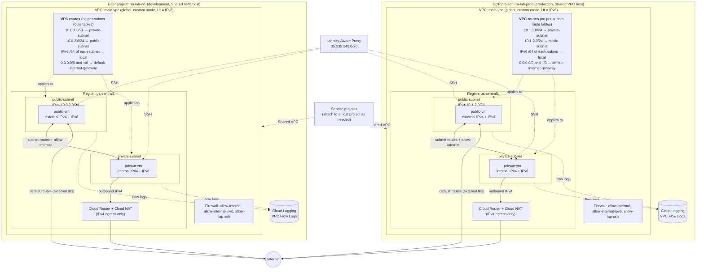

# Architecture

## Notes

- Two GCP projects, each a Shared VPC host: development (rm-lab-w1, 10.0.0.0/16) and production (rm-lab-prod, 10.1.0.0/16). The ranges do not overlap.
- Both use the same module (modules/network), with settings in envs/dev and envs/prod.
- GCP VPCs are global. The /16 ranges are only the space the subnets are carved from.
- GCP has no route tables. Routes belong to the VPC and apply to every subnet.
- Each environment has a test VM in each subnet.
- Both projects send VPC Flow Logs to Cloud Logging.
- Inbound internet traffic to the public VMs is blocked until you add an ingress firewall rule.
- Service projects are not created by this Terraform.
